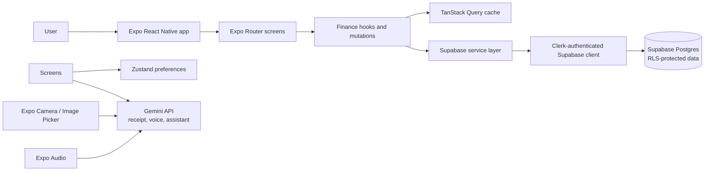
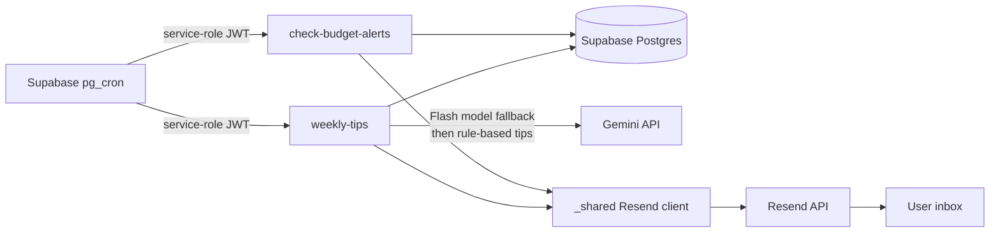

# ExpenseAi

ExpenseAi is an Expo/React Native personal-finance app for tracking accounts, income, expenses, budgets, and spending patterns. It supports manual entry, receipt scanning, voice entry, an AI finance assistant, and scheduled email summaries.

## Features

- Clerk sign-in and sign-up, onboarding, profile, currency preferences, and account management.
- Home dashboard with balances, monthly income/expenses, budget progress, category breakdown, and recent activity.
- Transactions with search, account/type filters, swipe-to-delete, and CSV export.
- Add transactions manually, from camera/gallery receipts, or from a recorded voice note.
- Gemini-powered receipt/voice extraction and finance assistant.
- Monthly budget alerts at 80% and 100%, plus weekly spending recaps and tips by email.

## Architecture



Scheduled email flow:



### Main code areas

| Path | Responsibility |
| --- | --- |
| `app/` | Expo Router auth, onboarding, dashboard, transactions, add, assistant, and profile screens |
| `components/` | Reusable transaction rows, account/budget sheets, currency/date pickers, scanner, recorder, and gradient actions |
| `hooks/` | Clerk-to-Supabase client, finance queries, user sync, and TanStack Query mutations |
| `lib/services/` | Supabase CRUD, Gemini assistant/extraction, and transaction export |
| `lib/schemas/`, `types/` | Zod form validation and shared data types |
| `constants/`, `store/` | Categories/theme and client preferences |
| `supabase/functions/` | Scheduled budget alerts, weekly tips, and shared email/admin helpers |
| `supabase/migrations/`, `supabase/cron.sql` | Email-job database fields/index and schedules |

## Stack and tooling

| Area | Tools |
| --- | --- |
| Mobile | Expo SDK 54, React Native 0.81, React 19, Expo Router |
| Language and validation | TypeScript 5.9, Zod 4 |
| Auth and data | Clerk Expo, Supabase JS/Postgres, PostgreSQL RLS |
| Server state | TanStack Query 5; Zustand for lightweight client preferences |
| Styling and motion | NativeWind 4, Tailwind CSS 3, Reanimated 4, React Native Gesture Handler, Expo Linear Gradient and Blur |
| Capture and files | Expo Camera, Image Picker, Audio, File System, Sharing |
| UI and charts | Expo Vector Icons, Safe Area Context, DateTimePicker, Gifted Charts |
| AI and email | Gemini API (Flash extraction fallbacks and weekly-tip fallbacks), Resend API |
| Backend jobs | Supabase Edge Functions (Deno), pg_cron, pg_net, Vault |
| Quality | ESLint with Expo config, TypeScript compiler, npm |

## Run locally

Requirements: Node.js/npm, an Expo-supported Android/iOS device or emulator, a Clerk application, and a Supabase project with the app tables and RLS policies configured.

1. Install packages:

   ```sh
   npm install
   ```

2. Create a root `.env` file (it is git-ignored):

   ```dotenv
   EXPO_PUBLIC_CLERK_PUBLISHABLE_KEY=pk_...
   EXPO_PUBLIC_SUPABASE_URL=https://YOUR_PROJECT_REF.supabase.co
   EXPO_PUBLIC_SUPABASE_KEY=YOUR_SUPABASE_ANON_OR_PUBLISHABLE_KEY
   EXPO_PUBLIC_GEMINI_API_KEY=YOUR_GEMINI_API_KEY
   ```

3. Start Expo:

   ```sh
   npx expo start
   ```

   Use `npm run android`, `npm run ios`, or `npm run web` for a specific target. Camera and microphone flows need a device or an emulator with those permissions available.

The Supabase client sends the signed-in Clerk token with requests. Configure Supabase RLS to authorize the Clerk subject (`auth.jwt() ->> 'sub'`) against each row's `user_id`/`clerk_id`. The app expects `users`, `accounts`, `transactions`, and `budgets` tables; the migration in this repo adds email-job fields/indexes and is not a replacement for the core app schema.

`EXPO_PUBLIC_*` values are bundled into the mobile app and are not secrets. The mobile AI flows currently call Gemini directly, so protect the Gemini key with project quota controls and move those calls behind an Edge Function before distributing a production build. Supabase's anon/publishable key is intended for client use only when RLS is correctly enabled.

## Supabase email jobs

Email functions are optional. To enable them:

1. Link the Supabase project and apply the migration:

   ```sh
   supabase link --project-ref YOUR_PROJECT_REF
   supabase db push
   ```

2. Set Edge Function secrets and deploy:

   ```sh
   supabase secrets set RESEND_API_KEY=YOUR_RESEND_API_KEY RESEND_FROM_EMAIL="ExpenseAi <alerts@your-verified-domain.com>" GEMINI_API_KEY=YOUR_GEMINI_API_KEY
   supabase functions deploy check-budget-alerts
   supabase functions deploy weekly-tips
   ```

3. Store `supabase_url` and `service_role_key` in Supabase Vault, then run `supabase/cron.sql` in the SQL editor. Jobs run daily and weekly at 09:00 UTC.

Resend only allows test-mode sends to the account owner. For real recipients, verify a domain you own and use a sender address on that domain. Keep service-role and Resend keys in Supabase secrets/Vault; never put them in the mobile `.env`.

## Bottlenecks and reliability

- **Repeated reads:** shared finance hooks use keyed TanStack Query caching (30-second stale time) and mutations invalidate account, transaction, or budget queries so screens stay in sync.
- **AI availability:** receipt/voice extraction tries Flash models in sequence with request timeouts. Weekly tips use model fallbacks and then generate rule-based tips if Gemini is missing or unavailable.
- **Email retries and duplicate sends:** Resend requests have a timeout and idempotency keys. Budget thresholds and weekly-send timestamps are stored in Postgres; failures are isolated per recipient and logged.
- **Large transaction histories:** email functions page transaction reads instead of relying on one capped query. For a large user base, move recipients to a cursor-based queue/batched worker; a single scheduled invocation still processes users sequentially and can hit the Edge Function time limit.
- **Debugging provider failures:** Supabase Edge Function logs contain the caught exception (for example missing secrets, database columns, or Resend sender verification); invocation details show status and duration.

## Checks

```sh
npx tsc --noEmit
npx expo lint
```
